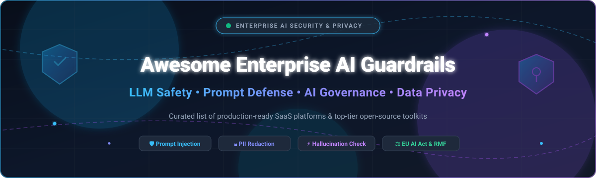

  

# 🛡️ Awesome Enterprise AI Guardrails & Privacy

  
  
  
  
  
  
  

---

## 🌟 Top Enterprise AI Guardrails & Privacy Ecosystem

> **A Curated List of SaaS Platforms & Open-Source Tools for Enterprise AI Security, LLM Safety, Prompt Defense, PII Anonymization & AI Governance**  
> *Last updated: March 2026* ⚡

This repository tracks battle-tested **SaaS platforms** and **open-source security tools** designed for **Enterprise AI Guardrails, Agentic Safety, and Data Privacy**. These systems empower organizations to safely deploy Generative AI applications and autonomous agents by dynamically intercepting prompt injections, jailbreaks, PII leakage, toxicity, hallucinations, and model supply-chain vulnerabilities — while ensuring regulatory compliance with the **EU AI Act**, **NIST AI RMF**, **GDPR**, and **HIPAA**.

---

## 📑 Table of Contents

- [📊 Sector Overview & Market Dynamics](#-sector-overview--market-dynamics)
- [🏢 SaaS / Hosted Enterprise Platforms](#-saas--hosted-enterprise-platforms)
- [💻 Open-Source GitHub Projects](#-open-source-github-projects)
- [📈 Star History](#-star-history)
- [🤝 How to Contribute](#-how-to-contribute)
- [💖 Support & Sponsorship](#-support--sponsorship)
- [⚠️ Disclaimer](#-disclaimer)

---

## 📊 Sector Overview & Market Dynamics

The global AI Guardrails and LLM Security market is estimated at approximately **USD 2B to 3B**, rapidly expanding at a CAGR of 25%+ toward an expected **USD 18B–27B+** over the next decade. The sector is currently **moderately to highly fragmented** rather than winner-take-all, characterized by rapid open-source innovation, specialized security startups, and aggressive M&A consolidation from legacy cybersecurity giants (e.g., Palo Alto acquiring Protect AI, Check Point acquiring Lakera, and F5 acquiring CalypsoAI).

---

## 🏢 SaaS / Hosted Enterprise Platforms

| Platform | Company Size (Revenue / Valuation) | Description | Pricing | Free Tier / Trial Limits |
| :--- | :--- | :--- | :--- | :--- |
| **[Salesforce Einstein Trust Layer](https://www.salesforce.com/products/secure-ai/)** | **~$200B+ Market Cap** ($41.5B+ ARR / FY26 Revenue) | Secure AI architecture built into Salesforce Platform with dynamic CRM grounding, PII masking, Zero Data Retention, toxicity detection, and audit trails. | Included in Enterprise & Unlimited Editions; advanced Agentforce / Einstein 1 tiers start at list price of **$550/user/month** (billed annually) or custom quotes. | **30-day free trial** available for Salesforce Enterprise Edition (includes standard platform features and trial credits). |
| **[Protect AI](https://protectai.com/)** | **~$500M–$700M Valuation** (Acquired by Palo Alto Networks; $129M funding raised) | AI security posture management, Guardian model scanner, and LLM supply-chain security against serialization attacks. | Annual commercial enterprise contracts starting at mid-five figures (~$35,000–$50,000+/year) via direct sales or AWS Marketplace (acquired by Palo Alto Networks). | **Free forever open-source ModelScan** tool for scanning local models; enterprise platform PoC/trial available upon sales request. |
| **[HiddenLayer](https://hiddenlayer.ai/)** | **~$350M–$500M Est. Valuation** ($150M+ total VC funding raised, Series B) | AI security platform providing ML model scanning, attack simulation, and Agentic Runtime Security for multi-turn sessions and tool calls. | Annual commercial enterprise contracts starting at mid-five figures (~$50,000+/year) scaled by model count and runtime deployment mode. | **Guided Proof-of-Concept (PoC) trial** available upon scheduled enterprise demo (no self-serve free forever tier). |
| **[Lakera Guard](https://platform.lakera.ai/)** | **~$300M Valuation** (Acquired by Check Point Software; $30M funding raised) | API-first runtime security layer for LLM and agent applications providing prompt injection defense, jailbreak prevention, and PII leakage guardrails. | **$0/month** for Community Tier; Enterprise tier starts at custom negotiated annual contracts (acquired by Check Point). | **Free forever Community tier** includes up to **10,000 API requests/month** with up to 8,000 tokens per prompt and SaaS dashboard access. |
| **[Arthur Shield](https://www.arthur.ai/product/shield)** | **~$250M Valuation** ($65M+ total venture funding raised) | Real-time LLM firewall and guardrail intercepting sensitive data leakage, hallucinations, prompt injection, and toxic responses. | Arthur Monitoring entry tiers start at **$60/month**; Arthur Shield enterprise runtime guardrail starts via custom annual enterprise agreements (~$30,000–$50,000+/year). | **14-day free trial** available for Arthur core evaluation/monitoring platform upon request (no self-serve free forever tier for Shield). |
| **[CalypsoAI](https://calypsoai.com/)** | **$180M Valuation** (Acquired by F5 Networks; $40M+ funding raised) | Real-time inference-layer security (Inference Defend) blocking prompt injections, jailbreaks, and data exfiltration. | Annual enterprise subscription starting at custom rates (acquired by F5 Networks for $180M). | **Guided enterprise Proof-of-Concept (PoC)** available upon sales request and demo (no public self-serve free tier). |
| **[Patronus AI](https://www.patronus.ai/)** | **~$150M–$200M Est. Valuation** ($70M total funding raised, Series B) | Automated evaluation, red-teaming, and guardrail API for hallucinations (Lynx model), toxicity, PII, and custom enterprise criteria. | **€0/month** (Monitor tier); **€6.99/device/month** (Light tier); **€69/month** (Pro tier up to 5 devices); custom for Business/Enterprise. | **Free forever Monitor tier** includes basic desktop app visibility and limited API scan units; Developer API offers free trial evaluation credits. |
| **[Credo AI](https://www.credo.ai/)** | **~$101M Valuation** ($36M+ total funding raised) | Enterprise AI governance, risk management, and compliance platform with GAIA assistant automating policy enforcement and audit trails. | Annual platform subscription starting between **$30,000 to $150,000/year** based on active AI use cases and compliance modules. | **Free access to AI Governance Insights Hub and templates**; enterprise platform evaluation via customized guided proof-of-concept (PoC) demo upon request. |
| **[Guardrails AI](https://guardrailsai.com/)** | **~$30M–$50M Est. Valuation** ($7.5M seed; acquired by Harvey) | Framework and Hub for input/output guards, PII filtering, and structured Pydantic data generation for LLM applications. | Core framework is **$0 (Apache 2.0 open source)**; Guardrails Pro / Managed Cloud starts via custom enterprise annual contracts or AWS Marketplace private offers. | **Free forever open-source** self-hosted engine with unrestricted local runs; Guardrails Hub public validators are free to pull and run. |

---

## 💻 Open-Source GitHub Projects

Curated open-source toolkits, libraries, and frameworks for self-hosting custom validators, red-teaming, PII filtering, and building vendor-independent AI guardrails. Sorted by GitHub star count (descending):

1. **[Promptfoo](https://github.com/promptfoo/promptfoo)**   
   CLI and open-source library (MIT) for LLM red teaming, automated penetration testing, security evaluations, and prompt injection defense. Integrates natively with CI/CD pipelines to catch LLM vulnerabilities prior to deployment.

2. **[DeepEval](https://github.com/confident-ai/deepeval)**   
   The Open-Source LLM Evaluation Framework (Apache-2.0). Unit tests LLM applications for hallucination detection, answer relevancy, toxicity, G-Eval custom metrics, and enterprise safety guardrails.

3. **[Phoenix](https://github.com/Arize-ai/phoenix)**   
   AI observability and evaluation platform (ELv2) providing OpenTelemetry-based LLM tracing, evaluation, hallucination detection, and real-time guardrail performance monitoring.

4. **[Microsoft Presidio](https://github.com/microsoft/presidio)**   
   Industry-standard context-aware, pluggable PII identification and anonymization service (MIT). Identifies sensitive entities (names, credit cards, emails, SSNs) and redacts or masks them across prompts and completions.

5. **[garak](https://github.com/leondz/garak)**   
   The LLM vulnerability scanner (Apache-2.0). Acts as an automated generative AI red-teaming tool probing models for prompt injection, jailbreaks, data leaks, hallucination, and toxic generation.

6. **[Guardrails AI](https://github.com/guardrails-ai/guardrails)**   
   Python framework (Apache-2.0) and Hub for adding input/output guards, enforcing PII redaction, detecting toxic content, and extracting structured data using Pydantic schemas. Includes Guardrails API server with OpenAI-compatible endpoints.

7. **[NeMo Guardrails](https://github.com/NVIDIA/NeMo-Guardrails)**   
   Leading open-source toolkit (Apache-2.0) by NVIDIA for programmable guardrails on conversational LLM systems. Uses the Colang modeling language to define input, dialog, retrieval, execution, and output rails.

8. **[Purple Llama / Llama Guard](https://github.com/meta-llama/PurpleLlama)**   
   Meta's umbrella project (MIT/Custom) for open trust and safety tools, featuring **Llama Guard**, **Prompt Guard**, and CyberSec Eval for content moderation and adversarial prompt filtering.

9. **[LLM Guard](https://github.com/protectai/llm-guard)**   
   Production-grade security toolkit (MIT) by Protect AI for LLM interactions. Offers modular scanners for prompt sanitization, secret/token detection, toxicity filtering, and sensitive data redaction.

10. **[Rebuff](https://github.com/protectai/rebuff)**   
    Multi-layered prompt injection detector (Apache-2.0) utilizing heuristic filtering, dedicated LLM detection, vector database embeddings, and canary tokens to stop prompt injection attacks.

11. **[HarmBench](https://github.com/centerforaisafety/HarmBench)**   
    Standardized evaluation framework (MIT) by the Center for AI Safety for automated red teaming, jailbreak robustness, and safety benchmarking of open and closed-source language models.

12. **[ModelScan](https://github.com/protectai/modelscan)**   
    Open-source model scanner (Apache-2.0) protecting against Model Serialization Attacks. Analyzes model files byte-by-byte (PyTorch, TensorFlow, Keras, Sklearn, Pickle) without executing arbitrary malicious code.

13. **[Vigil](https://github.com/deadbits/vigil-llm)**   
    Open-source security scanner and guardrail (MIT) detecting prompt injections, jailbreaks, and toxic inputs using signature detection, transformer models, and vector database similarity matching.

14. **[Sponsio](https://github.com/SponsioLabs/Sponsio)**   
    Runtime safety layer for AI agents (Apache-2.0). Validates autonomous agent actions against deterministic rules ("agent contracts") before tool execution.

15. **[Arthur Engine](https://github.com/arthur-ai/arthur-engine)**   
    Open-source engine (Apache-2.0) for LLM evaluation, task-based validation, and hallucination scoring in enterprise RAG workflows.

16. **[Inner Warden](https://github.com/InnerWarden/inner-warden)**   
    Open-source security agent (MIT) monitoring autonomous AI agents and runtime environments against privilege escalation and risky shell commands.

---

## 📈 Star History

---

## 🤝 How to Contribute

Contributions are warmly welcome! Help keep this enterprise AI safety index accurate and up to date:

1. 🍴 **Fork** the repository.
2. 🌿 Create a new feature branch (`git checkout -b feature/add-guardrail`).
3. 📝 Add or update entries in `README.md` following the established format (include name, links, pricing, free tiers, and star badges).
4. 🚀 Submit a **Pull Request** with a brief summary of additions or updates.

---

## 💖 Support & Sponsorship

Thank you for exploring and using **Awesome Enterprise AI Guardrails & Privacy**! 🙏

If this curated repository helps you secure your enterprise AI applications, please consider supporting the project:

- ⭐ **Star** this repository on GitHub to boost visibility!
- 🍴 **Fork** and share it with your security, ML, and engineering teams.
- ☕ **Sponsor or buy a coffee**: Show your appreciation on the [GitHub Sponsors Dashboard](https://github.com/sponsors/ishandutta2007)!

---

## ⚠️ Disclaimer

- This is a **community-curated index** for informational and educational purposes; inclusion does not constitute a formal commercial endorsement.
- Generative AI systems, agentic workflows, and guardrail platforms must strictly comply with regional data protection mandates (**GDPR**, **CCPA**, **EU AI Act**, **HIPAA**, and **NIST AI RMF**).
- Open-source implementations must be properly security-hardened, tested against adversarial red-team benchmarks, and monitored in production.

---

  Built with ❤️ for AI security engineers, ML platform leaders, and compliance officers worldwide.

